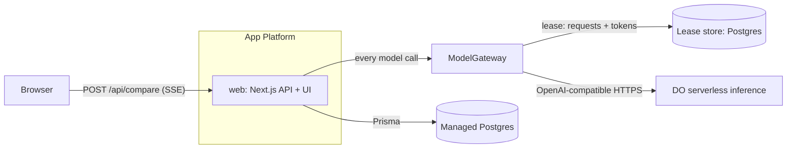
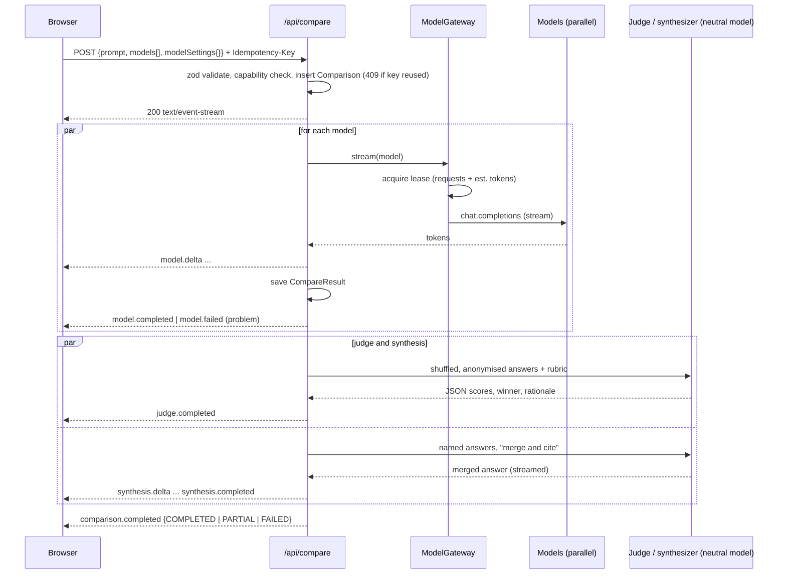

# Architecture and design decisions

## 1. The problem

### Framing

**Model FOMO** is decision anxiety: "did I pick the right model for *my* prompts, or am I overpaying / under-serving because I don't know what else is out there?" Customers on DigitalOcean can call dozens of hosted models through one key, which makes the choice cheap to change but hard to make.

**Personas**

| Persona | Situation | What they need |
| --- | --- | --- |
| App developer (primary) | Building a feature on DO serverless inference, picked a model from a blog post. | A fast, concrete answer for their prompt: which model, at what cost and latency. |
| Tech lead / platform owner | Owns the AI bill and quality bar for several features. | Evidence across many prompts, and a way to re-check when models change (DO keeps only the latest versions of each model). |
| PM / non-specialist | Wants to sanity-check output quality without reading API docs. | A UI where they can compare answers and say which one is better. |

**Job to be done:** *"When I'm choosing (or re-choosing) a model for a task, help me see how the alternatives compare on my prompts, so I can pick one with confidence and move on."*

**What success looks like** (PoC and beyond, see ROADMAP for later phases)

- Time from question to decision: one compare run gives a recommendation in under a minute.
- Decision confidence: share of comparisons where the user votes or rates (a proxy for "this was useful"), and judge/human agreement.
- Money saved: share of users who switch to a cheaper model at equal judge quality.
- Reliability: compare runs completing without a model error; 429s absorbed by the gateway rather than shown to users.

### How the PoC answers it

1. **Interactive compare.** One prompt, any number of the available models (no cap), each with its own settings (temperature, top P, max tokens, reasoning level, system prompt override), streaming side by side with latency, tokens and cost.
2. **Combined view, three ways.** (a) a **judge** scores the anonymised answers; (b) a **synthesizer** merges them into one answer that cites which model each part came from; (c) a **recommendation** turns judge quality plus cost and latency into "use X", weighted by the user's priority (quality, balanced, cost, speed), e.g. *"GLM-5.3 Flash is 95% as good as DeepSeek at 1/10th of the cost."*
3. **Human signal.** Thumbs up/down per answer and a "best answer" vote, stored for judge calibration and future tuning.
4. **Leaderboard.** Every comparison feeds a leaderboard that can be cut by task type.

One prompt is still an anecdote. Running a model set over the user's own prompt set (batch evals) is the obvious next step. It was built and then deliberately cut to keep the PoC small enough to defend line by line; see [DECISIONS.md](DECISIONS.md) and the [roadmap](ROADMAP.md).

Everything runs on DigitalOcean: models from **serverless inference** (OpenAI-compatible, `https://inference.do-ai.run/v1`, model access key), compute on **App Platform**, state in **Managed Postgres**.

### Caveat: what this account can call

On the account this PoC runs on, every Anthropic model and every proprietary OpenAI model returns `403 "not available for your subscription tier"`; `gpt-oss-120b` and the open-weight families (DeepSeek, GLM, Kimi, Qwen, MiniMax, Mistral, NVIDIA) work. That means the demo cannot show the most common FOMO question, *"is a cheap open model good enough versus a frontier model?"*. The catalog still lists the locked models (with "Not on plan") so the experience is honest about what exists. On a higher tier nothing in the code changes.

## 2. System overview



One service and one database. Every model call (answers, judge, synthesis) goes through one choke point, `ModelGateway`, so retries, timeouts and the rate-limit budget behave the same everywhere.

### Repository layout

A pnpm + Turborepo monorepo. Packages ship TypeScript source (no build step); Next.js transpiles them.

```
apps/web            Next.js App Router: UI, API routes, middleware
packages/shared     zod request schemas, SSE event types, RFC 9457 types (used by server AND client)
packages/llm        ModelGateway, Gradient + mock providers, judge, model catalog/pricing
packages/ratelimit  Lease-based rate limiter with Postgres / memory stores
packages/db         Prisma schema, migrations, client
```

Splitting `llm` and `ratelimit` out of the web app keeps them testable on their own, and lets a future background worker reuse them unchanged.

## 3. Interactive path: `POST /api/compare`

Pages: `/` links to a new compare and lists the latest runs; `/compare` is only the setup form; `/runs/:id` shows one run. Pressing Compare opens the SSE stream from a small client-side store (`lib/live-run.ts`) and moves to the run page as soon as the server sends `comparison.started` with the saved id, so the stream survives the page change. The run page reads from that store while the run is live in this tab, and from `GET /api/compare/:id` otherwise (past runs, shared links, a refresh). "Edit and rerun" goes back to `/compare?from=:id` with the form filled in.



Design points:

- **Validate before streaming.** Validation, the idempotency check and the database insert happen before the response starts, so those errors get a real HTTP status and a problem body. Once the stream is open, the HTTP status is already 200, so failures become events.
- **Per-model isolation (partial results).** Each model runs in its own promise that catches its own errors and always emits exactly one terminal event (`model.completed` or `model.failed`). This is `Promise.allSettled` semantics, written so each model also persists and reports as soon as *it* finishes rather than waiting for the slowest one.
- **Three timeouts.** A per-attempt timeout (60 s), a first-token timeout (20 s, catches stuck requests early), and an overall deadline for the comparison (15 min, generous because a run may wait out DO's per-minute limits several times).
- **Retries only before the first token.** If a stream fails after text reached the user, retrying would duplicate text on screen. The gateway retries only failures that happen before any token was sent; later failures surface as `model.failed` with the partial output kept.
- **A compare outlives the browser.** The run is not tied to the request's `AbortSignal`: if the tab closes or the network drops, the stream stops but the compare finishes on the server and is saved. Reopening the run page shows it as running and polls every 3 s until it ends. **Stop** is an explicit `POST /api/compare/:id/cancel`, which aborts the run's model calls (no more tokens spent) and saves it as `CANCELLED`. The registry of running compares is per process; with several web instances a cancel could land on the wrong one (the live app runs one). A run cut off by a restart would stay `RUNNING`, so a run still running 16 minutes after it started is marked `PARTIAL`/`FAILED` when read.
- **SSE, not WebSockets.** The flow is one-way (server to browser), SSE works over plain HTTP through App Platform's load balancer, and the client is about 30 lines. We use `fetch` + a small parser instead of `EventSource` because `EventSource` cannot POST a body. A heartbeat comment every 15 s keeps idle connections open through proxies.
- **Metrics per model:** time to first token, latency of the successful attempt, input/output tokens (from the provider's `usage`, or estimated and flagged with `*` if not reported), cost from the price table, and attempt count.

### The combined view: LLM-as-judge

After the answers finish, a judge model scores each one on accuracy, helpfulness, clarity and overall (1-10), picks a winner and writes a short rationale. Known judge biases and what we do about each:

| Bias | Mitigation |
| --- | --- |
| Position bias (favours an answer for where it appears) | Answers are shuffled, then judged **twice**, in that order and reversed (two parallel calls). Scores are averaged; if the two orders pick different winners, it is a **tie** (`positionConsistent: false`, shown as a badge) and neither model gets the win. |
| Self-preference (a model likes its own style) | Answers are anonymised as "Response A/B/C", and the judge is picked to be a model that is **not** competing (`pickJudgeModel` walks a preference list). If none is free, the verdict is flagged `selfJudged` and the UI shows a warning. |
| Verbosity bias | The rubric says not to reward length, and the judge panel shows each answer's word count next to its score. |
| No ground truth | None for an open prompt. The judge is presented as a second opinion, and human votes are stored next to it to measure agreement. |
| Prompt injection inside an answer | The rubric tells the judge to ignore instructions inside responses. |
| Unparseable output | Strict JSON contract validated with zod; one automatic re-ask on bad JSON; unknown labels are dropped. |

The judge is a second opinion, not ground truth, and the UI says so. Human votes (`PUT /api/compare/:id/vote`) are stored next to the judge's verdict. They measure judge/human agreement and are the seed data for the "learn from preferences" roadmap item.

### Synthesis: one merged answer, with attribution

The judge tells you *which* answer is best; the synthesizer gives you *the* best answer. It runs in parallel with the judge (both only need the finished answers), uses the same neutral model, and is told to keep only what the answers contain, resolve disagreements explicitly, and cite each sentence as `[Model name]`. The UI renders citations as chips, so the merged answer never hides where each claim came from, which is the point of FOMO. The output is stored on `Comparison.synthesis`.

Embedding-similarity consensus was considered and rejected: cheap, but agreement is not correctness.

### Recommendation: from scores to a decision

`apps/web/lib/recommend.ts` is a small pure function. Each answered model gets three 0..1 sub-scores: quality (judge overall / 10), cost (cheapest / this), speed (fastest / this). The user's priority picks the weights (quality 1/0/0, balanced 0.6/0.25/0.15, cost 0.4/0.6/0, speed 0.4/0/0.6) and the highest weighted sum wins. The sentence compares the pick to the highest-quality answer ("95% as good at 1/10th of the cost"). Unknown prices score as worst-case cost so we never recommend on a guess. The card says plainly that one prompt is a sample of one; running the same models over many prompts is the batch-eval roadmap item.

### Run metrics: what we measure, and how

Every call (compare, synthesis, judge) goes through the gateway, which records:

| Metric | Definition | Caveat |
| --- | --- | --- |
| TTFT | Attempt start to the first *visible* answer token | Reasoning models think first, so their TTFT includes thinking time |
| Total latency | Attempt start to the end of the stream (the successful attempt; queueing and retries show up as `attempts`) | |
| Speed (tokens/sec) | Output tokens / time from the first streamed chunk, answer *or* reasoning, to the end | Output tokens of reasoning models include hidden reasoning, which is billed; marked "incl. reasoning" |
| Tokens in / out | From the provider's usage report; estimated (marked `*`) if it sends none | |
| Cost | Tokens x list price per 1M from `catalog.ts`; unknown price shows "cost unknown", never $0 | |
| Effective price per 1M | This call's cost / all its tokens | Shows the real blended rate, e.g. a reasoning model's "cheap" list price after thinking tokens |

Speed is measured from the first chunk rather than from the request, so it is a property of the model's decoding, not of queueing or network setup; TTFT covers that part. A stream that breaks after text was shown is never retried, because the user is already reading it.

The leaderboard takes `?task=<type>` (UI pills, and `taskType` on `GET /api/leaderboard`), because "best model" depends on the job.

### Per-model settings and capabilities

Each selected model carries its own `temperature`, `topP`, `maxTokens`, `reasoningEffort` and `systemPrompt` override (`modelSettings` in the request, validated with zod; keys must be in `models`). Not every model accepts every parameter, so on 2026-11-26 we **probed every chat model** on DO with each parameter. Findings, encoded in `packages/llm/src/catalog.ts`:

| Model | Rejects |
| --- | --- |
| Kimi K2.6 | `temperature` (must be 1), `top_p` (must be 0.95) |
| Kimi K3 | `top_p` (must be 0.95) |
| Ministral 3 14B, GLM-5.2 | `reasoning_effort` |
| All Anthropic, proprietary OpenAI, Arcee | everything (403, not on this account's tier) |

The UI disables unsupported controls with the reason, the server rejects explicit unsupported settings with a 400 problem pointing at the exact field, and request-level defaults (e.g. temperature 0.7) are silently left out for models that reject them. What was actually sent is stored per result (`CompareResult.settings`) so any comparison can be reproduced.

### Reasoning models and timeouts

Reasoning models (GLM, Kimi, DeepSeek, gpt-oss) stream hidden "thinking" before any answer text, sometimes for 20-30 s. The original first-token timeout (20 s) killed them before they answered. The provider now reports reasoning chunks as a liveness signal (`{type: "thinking"}`), which stops the first-token timer without counting as TTFT. If a model spends its whole `max_tokens` on reasoning (`finish_reason: "length"` with no text), the provider raises a `token_budget` error instead of returning an empty answer. A plain retry would fail the same way, so the gateway retries **once with 4x the budget (capped at 8,192)**, reports "ran out of tokens while reasoning, retrying with max tokens N" while it waits, and records `maxTokensRaisedTo` on the result, so the answer card says so. If the bigger budget runs out too, the call fails with a clear message ("raise max tokens or lower the reasoning level"). The default max tokens in the UI is 2048: enough for most answers, and the retry covers the heavy thinkers without making every call reserve (and wait for) 8k tokens.

## 4. Reliability: the `ModelGateway`

Every model call goes through `ModelGateway` (`packages/llm/src/gateway.ts`). Each attempt:

1. **Takes a lease** from the shared rate limiter (one request + estimated tokens).
2. **Calls the provider** with a per-attempt timeout (and a first-token timeout for streams).
3. **Releases the lease** with the actual token usage.

### Retries: exponential backoff with full jitter

Retried: 429, 408, 409, 425, 5xx (including 529 "overloaded"), timeouts and network errors. Not retried: other 4xx (bad request, unknown model, auth), because they fail the same way again.

```
delay = random(0, min(cap, base * 2^(attempt-1)))      # full jitter
if the server sent Retry-After / retry-after-ms:
  delay = max(retryAfter + small random spread, delay)   # never earlier than asked
```

Full jitter (randomising the whole delay, not adding a little noise) spreads retries from many clients evenly, so they don't all hit the provider again at the same instant after a shared 429. The OpenAI SDK's built-in retries are turned off (`maxRetries: 0`) so attempts don't multiply across two layers.

### Retry policy, end to end

The rule: retry what a second attempt can fix; fail fast and clearly on what it can't; never show a user the same text twice.

| Failure | What happens | Why |
| --- | --- | --- |
| 429 rate limited | Retried, never sooner than `Retry-After` or, since DO sends none, the reset time of the counter its headers show as spent. If that is further away than the caller will wait (5 min for compare), it fails at once with a clear "rate limited" problem. Sets a shared cooldown and halves the bucket's AIMD factor. | Capacity comes back; every instance should slow down, not just this one. Retrying before the reset only collects more 429s. |
| 5xx, 529, 408/409/425, timeouts, network errors | Retried with backoff and full jitter. Up to 3 attempts, 60 s each. | Usually transient. |
| No first token in 20 s | Counts as a timeout and is retried. Reasoning chunks count as "alive". | A hung connection looks like silence; a thinking model does not. |
| Reasoning used all of `max_tokens` | One retry with 4x the budget (max 8,192), shown on the card. | The same request fails the same way; a bigger budget is the fix. |
| Other 4xx (bad request, unknown model, plan not allowed) | Not retried; shown as a problem with the model's name. | It would fail identically. |
| Stream drops after text was shown | Not retried; the partial answer stays, marked failed. | Retrying would repeat text on screen. |
| One model fails | The others carry on; the run ends `PARTIAL`. The judge and synthesis need two answers, and failed models are left out of every chart and "best" pick. | One bad model must not hide the rest. |
| Judge returns bad JSON | Asked once more; if it still fails, the answers and metrics stand without scores. | The judge is a second opinion, not a dependency. |
| User closes the tab | The compare keeps running and is saved; the run page picks it up again. | The user asked for the answers; coming back later should find them. |
| User presses Stop | The server's calls are aborted (no tokens wasted) and the run is saved as `CANCELLED`. | An explicit request to stop spending. |

Known gaps: the tokens spent by a failed attempt are not added to the run's cost (only the successful attempt is measured), and a run page reopened mid-run shows each answer when it is saved, not token by token (the live text only streams to the tab that started it). Publishing deltas through a pub/sub hop would close that gap.

### Staying under the limits: leasing

Retrying 429s is reactive. To stay *within* the limits in the first place, every process takes a **lease** from a shared store before calling a model.

**The real numbers.** DO doesn't publish per-model limits for serverless inference, but every response carries `x-ratelimit-*` headers. Measured on 2026-11-26 with this project's key:

| Header | glm-5.3-flash | mistral-3-14B | Notes |
| --- | --- | --- | --- |
| `limit-requests` | 120 | 120 | per minute, **per model** (each model has its own counter) |
| `limit-tokens-per-minute` | 1,500,000 | 1,000,000 | differs by model |
| `limit-tokens-per-day` | 45,000,000 | 30,000,000 | |
| `remaining-tokens-per-day` | ~4.5M | ~3.0M | about 10% of the limit right after light use; we trust the smaller number |
| `reset-*` | epoch seconds | epoch seconds | e.g. `1795712400`, usually the next minute boundary (sometimes a few seconds off) |

So the budget is **per (access key, model)**, not per account, and the right numbers have to be learned rather than configured.

**How DO behaves under a burst** (measured on 2026-11-27 by firing 60-plus calls at one model):

- A 429 carries **no `Retry-After`**. The body names the counter that ran out (`requests_per_minute`), and the `x-ratelimit-reset-*` header of the counter at 0 remaining says when it frees up.
- The counter behaves like a **sliding window counter**: after a burst, every call gets a 429 until about the minute boundary, then `remaining` grows by roughly 2 per second rather than jumping back to the full limit.
- Before the fix, a 429 retry slept about 70 ms (plain backoff) against a 5.8 s reset and simply collected more 429s. Now it waits for the reset (measured: slept 8.31 s for an 8.25 s reset) and then succeeds.

**The strategy:**

1. **One bucket per (key, model).** Bucket name `gradient:<sha256(key)[:10]>:<model>`: two keys never share a budget, and the key itself is never stored. (`RATE_LIMIT_BUCKET=account` collapses to one bucket per key for providers that limit per account.)
2. **Learn limits from headers.** The provider parses the headers on every response (and on 429 errors) and the gateway calls `limiter.observe()`. Learned limits replace the configured fallback (`RATE_LIMIT_RPM`/`TPM`, used until the first response) at 90% (`LEARNED_SAFETY`), and expire after an hour without a fresh header. If a header says a counter is at **0 remaining** (per minute or per day), the bucket is put into cooldown until that counter's reset, instead of collecting 429s.
3. **Reserve the worst case, then reconcile.** A lease reserves 1 request and *prompt estimate + `maxTokens`* tokens inside a sliding 60 s window, plus an in-flight slot (with a TTL, so a crashed caller can't hold it). The TTL is at least the caller's attempt timeout plus 30 s (`holdMs` on `acquire`), so a slow but healthy call never loses its slot mid-call; only a crashed caller's lease expires. The prompt is counted with tiktoken's o200k tokenizer (`js-tiktoken`, pure JS): exact for gpt-oss, and unlike "4 characters per token" it sees that code and non-English text use more tokens per character (a line of code: 27 tokens, not 12; a Chinese sentence: 14, not 5). The other families (DeepSeek, Mistral, GLM, Kimi, Llama) have their own tokenizers, so the count is scaled per model by a learned correction: every reported usage updates a moving average of actual / counted input tokens (`TokenCalibration`, clamped to 0.5-3x). On completion the estimate is replaced with the real usage, which returns unused budget. Failed attempts are charged 0 tokens for a 429/4xx (rejected before generation) and the full reservation for timeouts/5xx (unknown, so we over-count, the safe direction).
4. **AIMD when the limits are wrong.** Each bucket has a factor (starts at 1) that scales all its limits. A real 429 halves it (multiplicative decrease, floor 0.1); each finished call adds 0.05 (additive increase). Parallel 429s from one burst count once (a 5 s debounce), and a cooldown *predicted* from the headers ("0 left until the reset") does not halve it, because the limit is known and only this window is spent. An earlier version halved twice per burst, which the stress test caught. This finds the real capacity when another app shares the key or the provider changes limits without saying so. The 429 also sets a **shared cooldown** until the reset, so every instance backs off, not just the one that got it.
5. **Waiting.** With no capacity, the caller sleeps (with jitter) until the oldest lease leaves the window, up to its wait budget (5 min for compare; the run carries on even if the tab is closed). The UI shows "waiting for capacity".

Because every web instance leases from the same store, the *whole system* stays under the limits. Per-process limiters would each think they had the full budget.

We tried one more rule and reverted it: cooling down when a counter was *nearly* spent (10% left). Because DO refills gradually, that blocked the bucket for a whole window while capacity was coming back, and p95 wait rose to 117 s.

The arithmetic lives in `packages/ratelimit/src/policy.ts` (`effectiveLimits`):

```
base      = learned limit × 0.9, or the configured fallback
effective = base × aimdFactor
```

### Seeing it: rate events and `/ops/rate-limits`

Every decision the limiter and the gateway make is one event (`packages/ratelimit/src/events.ts`): lease granted (with how long it waited and the bucket's level), lease wait, lease timeout, lease released (tokens reserved vs used), 429 (with DO's headers), cooldown (and why: a real 429 or a header saying 0 left), limits learned, AIMD factor changed, retry (the delay actually slept, split into backoff ceiling, jitter draw and server-requested wait) and attempt ok/failed (latency, DO's `x-request-id` and `do-upstream-service-time`). Each event carries the comparison id, so one compare can be replayed on its own.

`PostgresEventSink` buffers them and writes one insert per second into `rate_event`; it never blocks or fails a model call, drops events rather than grow without bound if the database is away, and prunes rows after 7 days (`RATE_EVENTS=off` turns it off). `/ops/rate-limits` draws a per-model timeline (requests in our window vs the effective limit, the AIMD factor, and bars for cooldowns and retry sleeps) with a summary table, for the last N minutes or for one compare (`?tag=<comparison id>`). It is an ops view for engineers, so the app's nav does not link to it. `GET /api/ops/rate-events` returns the same data for offline analysis.

Why not OpenTelemetry for this? These are domain decisions (why a call waited, what a retry slept), not spans, and Postgres is already there. An OTel exporter would be one more `RateEventSink`.

**Measured: many people comparing at once** (2026-11-27, local app against live DO, `scripts/stress-compare.mjs`, about $0.02 in total):

| Burst | Calls | 429s from DO | Answered | What happened to the rest |
| --- | --- | --- | --- | --- |
| 80 compares × 2 models, at once | 160 | 0 | 123 | All 37 failures were on the reasoning model (`glm-5.3-flash`): a small `max_tokens` made calls retry with a bigger budget, which used up its share sooner. The rest waited (p95 about 10 s) and then failed with "rate limited" when the 15 s budget ran out. |
| 150 compares × 2 models, at once | 300 | 0 | 139 | `mistral-3-14B` answered exactly 108 (120/min × 0.9) and the other 42 waited until the 15 s budget ran out; `glm-5.2` answered 31, again slowed by budget retries. Nothing reached DO above the limit. |
| 150 compares × 2 models, at once, 5 min wait budget (after the change) | 300 | 0 | **300** | Every answer arrived. Calls queued for their model's capacity (p95 wait 63 s for `mistral-3-14B`, 88 s for `glm-5.2`), and the slowest compare finished in 102 s. |

What this says: the shared lease keeps the whole app inside DO's per-model limit, so a crowd produces short waits and clear "rate limited, try again in N s" errors, never a storm of 429s or retries. The limit is **per model**, so 100 different models in flight don't compete with each other; the ceiling bites when many people pick the *same* model in the same minute (about 108 answers a minute each, on one key). Raising it means a higher DO tier, one key per customer (phase 1 of the roadmap), or spreading load across equivalent models.

After this test the compare wait budget went from 15 s to 5 minutes (6 attempts, 429 retries waiting for DO's reset), because a compare no longer depends on the tab staying open. Rerun with the same 150 compares: see the third row of the table above.


### Lease store: Postgres

`LeaseStore` is a small interface (`tryAcquire(bucket, tokens, limits)`, `release`, `coolDown`, `observe`) with two implementations that pass the same contract test suite (learned limits, AIMD, reconciliation, cooldowns, and "20 concurrent acquires never over-grant"), run against real Postgres in CI.

| | Postgres (live) | Memory |
| --- | --- | --- |
| Selected by | `LEASE_STORE=postgres` (default) | `LEASE_STORE=memory` |
| Atomicity | Transaction + `pg_advisory_xact_lock(hashtext(bucket))` | Single thread |
| Clock | Database `now()` | Process clock |
| Learned limits + AIMD factor | Per process | Per process |
| Good for | Several web instances sharing one budget, with no extra infrastructure | Unit tests, one process |

Postgres is already there for app data, and at tens of calls per second a 1-3 ms transaction is negligible next to a multi-second model call. **Why not Valkey (DO Managed Caching)?** It is the better store at high call rates (one atomic Lua script per acquire, keys that expire on their own, learned limits shared across instances), and an earlier version of this repo had one. It was removed: the live app never used it (the account is at its database cluster limit), and an unused store is code to maintain and defend for no benefit. Adding it back is one more `LeaseStore` implementation behind the same contract tests.

## 5. API design

- **Validation:** every route is wrapped by `apiRoute()` (`apps/web/lib/server/api.ts`), which parses params, query and body with zod schemas from `packages/shared`. The client imports the same inferred types, so client and server cannot drift. The wrapper also enforces `Content-Type: application/json` (415), a 1 MB body limit (413) and valid JSON (400).
- **Errors: RFC 9457 Problem Details.** Every error is `application/problem+json`:

  ```json
  {
    "type": "/problems/validation-error",
    "title": "Validation failed",
    "status": 400,
    "detail": "The request is invalid.",
    "instance": "/api/compare",
    "requestId": "6b93f687-…",
    "errors": [{ "pointer": "body.models", "message": "Models must be unique" }]
  }
  ```

  `type` URIs resolve to human-readable docs at `/problems/<slug>`, as the RFC recommends. Extension members: `requestId` (ties a client error to the server log line), `errors` (field-level validation), `retryAfterMs`, `model`, `upstreamStatus`. Unknown errors become a generic 500 with no internal details leaked (tested). The same problem shape is used inside SSE `model.failed` / `judge.failed` events and stored with failed results, so a failure looks the same everywhere. Unknown `/api/*` paths return a problem-shaped 404, not Next's HTML page.
- **Status codes that mean something:** `409` for a reused compare key (with the existing `comparisonId`), `422` for a key reused with a different body, `503` + `Retry-After` when a dependency is down.
- **Idempotency:** `Idempotency-Key` header (IETF draft) on `POST /api/compare`, which costs money; `PUT` for votes, which is idempotent by definition.
- **Pagination:** cursor based (`?limit&cursor`), stable under inserts.
- **Middleware, ready for auth:** `middleware.ts` assigns or propagates `x-request-id` and calls `authenticate()`, which today returns an anonymous principal. Adding auth means implementing that one function (verify a session, JWT or API key, return `null` for 401). Route handlers already receive `principal`. The principal header is always overwritten by middleware, so clients cannot spoof it.
- **Observability:** one structured JSON log line per request (request id, method, path, status, duration), plus warnings per failed model call, plus the rate-event log (`GET /api/ops/rate-events`, drawn at `/ops/rate-limits`).

## 6. Data model

`Comparison` → `CompareResult` (one per model), `Judgement`, `Vote`. `rate_lease` and `rate_cooldown` back the Postgres lease store; `rate_event` records its decisions (see section 4).

Metrics are stored per call so the leaderboard can compute averages, win rates and error rates. It aggregates on read, which is fine at PoC scale; at scale it becomes a materialised view refreshed on a schedule.

## 7. Deployment on App Platform

`.do/app.yaml`:

- **web** service: Dockerfile build, health check on `/api/health` (checks the database).
- **migrate**: a `PRE_DEPLOY` job running `prisma migrate deploy`, so the schema is migrated before new code takes traffic.
- **Managed Postgres** for app data and the lease store.
- Secrets (`type: SECRET`): `DO_MODEL_ACCESS_KEY`, `DATABASE_URL`.

One root `Dockerfile` builds the image for both the web service and the migrate job.

**The live PoC** runs a dev-sized variant of the spec: 1 web instance (`apps-s-1vcpu-1gb`), and a separately created Managed Postgres cluster (`db-s-1vcpu-1gb`, nyc3) wired in by a secret URL rather than the spec's `databases:` block (the account's database limit refused a spec-managed cluster). About $36/mo for the app plus $15/mo for the database.

Operational notes: each instance opens a Prisma pool. Small managed Postgres plans allow about 20-25 connections, so add a connection pool (PgBouncer, built into DO Managed Postgres) before scaling out instances. The compare route's `maxDuration` matches the run deadline (900 s); on App Platform's long-running Node server a run continues after its response closes anyway.

### Why App Platform, and when DOKS

| | App Platform (chosen) | DOKS (documented, not provisioned) |
| --- | --- | --- |
| Setup | One spec file, builds from GitHub on push, managed TLS and load balancing. | Cluster, ingress controller, cert-manager, registry, image builds in CI. |
| Cost at PoC size | ~$36/mo (2 × 1 GB containers) | ~$41/mo minimum (1 × 4 GB node $24 + load balancer $12 + registry $5), more for HA. |
| Operations | Nothing to patch; logs and metrics built in. | Node upgrades, ingress, cert renewals, observability are ours. |
| Flexibility | No sidecars, no custom autoscaling signals, no GPU, per-component sizes only. | Anything Kubernetes can do: HPA on queue depth, sidecars (OTel collector), co-located self-hosted models or observability (Langfuse/SigNoz). |

App Platform is the right call for the PoC and for a first production version. Move to DOKS when one of these becomes true: a background worker (batch evals) needs to autoscale on queue depth, we self-host something next to the app (observability stack, a reranker, a small fine-tuned model on GPU nodes), or several services share one cluster. We briefly provisioned a cluster and deleted it unused, and a Helm chart for it was removed from the repo too: for one app, the extra moving parts bought nothing yet, and an untested chart is not a migration path.

## 8. Technology choices and tradeoffs

| Choice | Why | Tradeoff |
| --- | --- | --- |
| **TypeScript end to end** | One language for UI, API and shared types; zod schemas shared by client and server. Fast to iterate, easy to review. | **Why not Rust:** the work is I/O-bound (waiting on models), so Rust's CPU advantages don't matter here, and it would split the codebase across two languages and slow the PoC. Revisit for a high-throughput gateway proxy. |
| **Next.js route handlers as the API** | One deployable for UI and API, native streaming responses. | API scaling is coupled to UI scaling. If the API grows, the `llm`/`ratelimit` packages lift out into a standalone service unchanged. |
| **OpenAI SDK against DO's endpoint** | DO serverless inference is OpenAI-compatible; the official SDK gives typed streaming and error classes. | Provider-specific features (if any) need a different client. `ChatProvider` is the seam. |
| **Prisma** | Typed queries, migrations, readable schema. | Raw SQL is still used where it's clearer (advisory locks in the lease store). |
| **Postgres for everything** (data, leases) | One managed dependency to run, back up and reason about. | It becomes the bottleneck first; leases are the first thing to move to Valkey (one more `LeaseStore`). |
| **SSE over WebSockets** | One-way stream, plain HTTP, trivial client. | No client-to-server messages mid-stream (not needed: cancel = close the request). |
| **LLM-as-judge for the combined view** | Scales, explains itself, works on any prompt with no labels. | Biased and fallible; mitigated (section 3) and paired with human votes. |

## 9. Known limitations

- Token counts use the o200k tokenizer with a learned per-model correction (kept per process, so a new instance relearns in a few calls). Each family's own tokenizer would be exact from the first call, at the cost of one tokenizer per family.
- `stream_options.include_usage` is requested for streaming usage; DO's docs don't say whether it's honoured. If it isn't, tokens are estimated and flagged. Set `GRADIENT_STREAM_USAGE=0` if the endpoint rejects it.
- No auth, per-user quotas or inbound rate limiting yet (the middleware hook is where they go).
- Prices are a static table from DO's pricing page (2026-11-26) using the base tier; long-context tiers aren't modelled.
- The leaderboard mixes judge scores from different prompts and judges; it's indicative, not a benchmark.
- Model capabilities and plan availability are a static table from one probe (2026-11-26). A periodic re-probe (or reading DO's model metadata, if it exposes this) would keep it current.
- Tool calling is shown in the UI as "coming later" and is not implemented.
