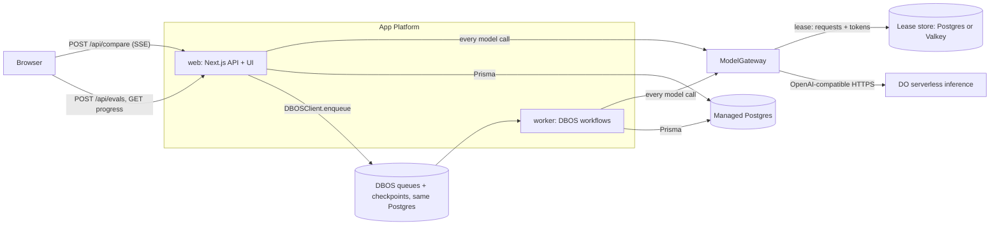
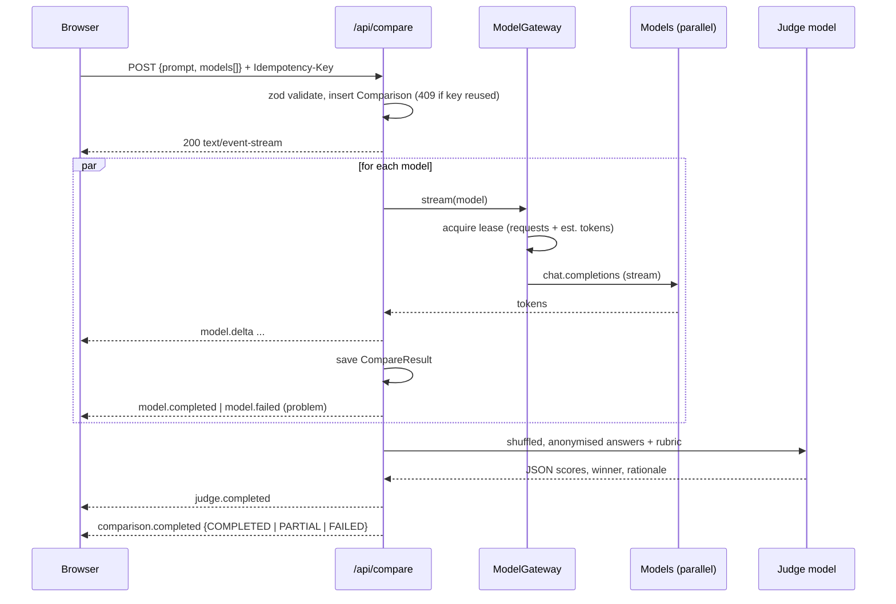

# Architecture and design decisions

## 1. The problem

Customers on DigitalOcean can pick from dozens of hosted models and worry they picked the wrong one ("Model FOMO"). This PoC answers that worry two ways:

1. **Interactive compare.** Send one prompt to up to six models at once, watch them stream side by side, and get a combined view: an independent judge model scores the anonymised answers, picks a winner and explains why, next to each model's latency, tokens and cost. The user can also vote for the answer they prefer.
2. **Batch evals.** "Is model X better *for my workload*?" needs more than one prompt. A batch run takes a prompt set × a model set, runs every call in a durable background worker, judges each prompt, and feeds a leaderboard.

Everything runs on DigitalOcean: models from **serverless inference** (OpenAI-compatible, `https://inference.do-ai.run/v1`, model access key), compute on **App Platform**, state in **Managed Postgres**, optionally **Managed Caching (Valkey)**.

## 2. System overview



Two paths with different needs:

| | Interactive compare | Batch evals |
| --- | --- | --- |
| User expectation | First token in about a second, finished in seconds | Minutes are fine, must not lose work |
| Transport | SSE stream from the web service | `202 Accepted`, then poll progress |
| Executes in | Web request | Worker (DBOS durable workflows) |
| On a crash | User clicks run again | Workflow resumes from its last checkpoint |
| Retry budget | Small (3 attempts, 15 s queue wait) | Large (5 attempts, 5 min queue wait) |

Both paths share one choke point for model calls, `ModelGateway`, so retries, timeouts and the rate-limit budget behave the same everywhere.

### Repository layout

A pnpm + Turborepo monorepo. Packages ship TypeScript source (no build step); Next.js transpiles them and the worker runs on `tsx`.

```
apps/web            Next.js App Router: UI, API routes, middleware
apps/worker         DBOS worker: eval workflows and queues
packages/shared     zod request schemas, SSE event types, RFC 9457 types (used by server AND client)
packages/llm        ModelGateway, Gradient + mock providers, judge, model catalog/pricing
packages/ratelimit  Lease-based rate limiter with Postgres / Redis / memory stores
packages/db         Prisma schema, migrations, client
```

Splitting `llm` and `ratelimit` out of the web app is what lets the worker reuse them unchanged.

## 3. Interactive path: `POST /api/compare`



Design points:

- **Validate before streaming.** Validation, the idempotency check and the database insert happen before the response starts, so those errors get a real HTTP status and a problem body. Once the stream is open, the HTTP status is already 200, so failures become events.
- **Per-model isolation (partial results).** Each model runs in its own promise that catches its own errors and always emits exactly one terminal event (`model.completed` or `model.failed`). This is `Promise.allSettled` semantics, written so each model also persists and reports as soon as *it* finishes rather than waiting for the slowest one.
- **Three timeouts.** A per-attempt timeout (60 s), a first-token timeout (20 s, catches stuck requests early), and an overall deadline for the comparison (150 s).
- **Retries only before the first token.** If a stream fails after text reached the user, retrying would duplicate text on screen. The gateway retries only failures that happen before any token was sent; later failures surface as `model.failed` with the partial output kept.
- **Client disconnect cancels upstream calls.** The request's `AbortSignal` flows down to the OpenAI SDK, so closing the tab stops spending tokens.
- **SSE, not WebSockets.** The flow is one-way (server to browser), SSE works over plain HTTP through App Platform's load balancer, and the client is about 30 lines. We use `fetch` + a small parser instead of `EventSource` because `EventSource` cannot POST a body. A heartbeat comment every 15 s keeps idle connections open through proxies.
- **Metrics per model:** time to first token, latency of the successful attempt, input/output tokens (from the provider's `usage`, or estimated and flagged with `*` if not reported), cost from the price table, and attempt count.

### The combined view: LLM-as-judge

After the answers finish, a judge model scores each one on accuracy, helpfulness, clarity and overall (1-10), picks a winner and writes a short rationale. Known judge biases and what we do about each:

| Bias | Mitigation |
| --- | --- |
| Position bias (favours the first answer) | Answers are shuffled before judging. |
| Self-preference (a model likes its own style) | Answers are anonymised as "Response A/B/C", and the judge is picked to be a model that is **not** competing (`pickJudgeModel` walks a preference list). If none is free, the verdict is flagged `selfJudged` and the UI shows a warning. |
| Verbosity bias | The rubric says not to reward length. |
| Prompt injection inside an answer | The rubric tells the judge to ignore instructions inside responses. |
| Unparseable output | Strict JSON contract validated with zod; one automatic re-ask on bad JSON; unknown labels are dropped. |

The judge is a second opinion, not ground truth, and the UI says so. Human votes (`PUT /api/compare/:id/vote`) are stored next to the judge's verdict. They measure judge/human agreement and are the seed data for the "learn from preferences" roadmap item.

Alternatives considered: a "synthesis" answer that merges all responses (useful, but it hides which model was right, which is the whole point of FOMO; it is on the roadmap as "council" mode), and embedding-similarity consensus (cheap, but agreement is not correctness).

## 4. Reliability: the `ModelGateway`

Every model call, from the web app or the worker, goes through `ModelGateway` (`packages/llm/src/gateway.ts`). Each attempt:

1. **Takes a lease** from the shared rate limiter (one request + estimated tokens).
2. **Calls the provider** with a per-attempt timeout (and a first-token timeout for streams).
3. **Releases the lease** with the actual token usage.

### Retries: exponential backoff with full jitter

Retried: 429, 408, 409, 425, 5xx (including 529 "overloaded"), timeouts and network errors. Not retried: other 4xx (bad request, unknown model, auth), because they fail the same way again.

```
delay = random(0, min(cap, base * 2^(attempt-1)))      # full jitter
if the server sent Retry-After / retry-after-ms:
  delay = max(retryAfter + small random spread, delay)   # never earlier than asked
```

Full jitter (randomising the whole delay, not adding a little noise) spreads retries from many clients evenly, so they don't all hit the provider again at the same instant after a shared 429. The OpenAI SDK's built-in retries are turned off (`maxRetries: 0`) so attempts don't multiply across two layers.

### Staying under the token budget: leasing

Retrying 429s is reactive. To stay *within* the account's limits in the first place (DO's tiers are per account, e.g. Tier 1 is 120 requests/min and 1.5M tokens/min, shared across all models), every process takes a **lease** from a shared store before calling a model:

- A lease reserves **1 request** and **estimated tokens** (prompt estimate + `maxTokens`, the worst case) inside a **sliding window** (default 60 s).
- It also occupies an **in-flight slot** until released, capping concurrency. A lease has a **TTL**, so a crashed caller cannot hold a slot forever.
- On completion the lease is **reconciled**: the estimate is replaced by the real token count, which returns unused budget to the window. Failed attempts are charged 0 tokens for a 429/4xx (rejected before generation), and the full reservation for timeouts/5xx (unknown, so we over-count, which is the safe direction).
- If there's no capacity, the caller waits (with jitter) until the oldest lease leaves the window, up to its wait budget (15 s interactive, 5 min batch). The UI shows "waiting for capacity".
- When the provider still returns a 429, the gateway sets a **shared cooldown** on the bucket for the `Retry-After` period, so every web instance and the worker back off, not just the one that got the 429.

Because the web instances and the worker all lease from the same store, the *whole system* stays under the limit. Per-process limiters would each think they have the full budget.

Budgets can be one per access key (`RATE_LIMIT_BUCKET=account`, matches how DO enforces tiers) or one per model (`model`).

### Lease stores: Postgres by default, Valkey optional

`LeaseStore` is a three-method interface (`tryAcquire`, `release`, `coolDown`) with three implementations that pass the same contract test suite, including a "20 concurrent acquires never over-grant" test.

| | Postgres (default) | Redis / Valkey | Memory |
| --- | --- | --- | --- |
| Extra infra | None (already have it) | DO Managed Caching | None |
| Atomicity | Transaction + `pg_advisory_xact_lock(hashtext(bucket))` | One Lua script (atomic in Redis) | Single thread |
| Clock | Database `now()` | Redis `TIME` | Process clock |
| Cost per acquire | A short transaction (~1-3 ms) | One round trip (<1 ms) | None |
| Good for | PoC and moderate traffic | High call rates, many instances | Unit tests, one process |

Postgres is the default because the PoC should need no extra infrastructure, and at tens of calls per second a short transaction per call is negligible next to a multi-second model call. The advisory lock is per bucket, so different buckets never contend, and it is released automatically on commit or rollback. If the lease table becomes hot (hundreds of calls per second), switch `LEASE_STORE=redis`: the interface doesn't change. Both stores take time from the server, not the caller, so instances with skewed clocks still agree on the window.

Two layers of flow control exist in the batch path and that's deliberate: DBOS queue concurrency and rate limits are **coarse, per-worker** limits that stop the worker from starting hundreds of steps that would only sit waiting; the lease store is the **precise, global** budget shared with the web app.

## 5. Batch path: durable evals with DBOS

`POST /api/evals` writes the run (prompts, models, judge) and enqueues one workflow. The worker executes:

```
evalRunWorkflow(run)                          queue: eval-runs     (2 per worker)
  └─ evalPromptWorkflow(run, prompt i)        queue: eval-prompts  (8 per worker)
       ├─ modelCallWorkflow(run, i, model)    queue: model-calls   (8 per worker, 60/min)
       └─ step: judge prompt i
  └─ step: finalize run (COMPLETED | PARTIAL | FAILED)
```

**Why durable workflows?** A 50 prompt × 5 model run is 250 paid model calls plus 50 judge calls, over several minutes. App Platform redeploys and restarts containers. Without durability, a restart either loses the run or re-runs everything and pays twice. DBOS checkpoints each step's result in Postgres. After a crash, the next worker resumes each workflow from its last completed step.

Verified locally: killing the worker with `kill -9` after 13 of 36 model calls, then restarting it, completed the run with exactly 36 `callModel` step outputs in DBOS's tables (no call made twice).

**Idempotency at every layer:**

- **HTTP:** `Idempotency-Key` on `POST /api/evals`. Same key + same body returns the original run (`200`, `Idempotent-Replayed: true`). Same key + different body returns `422`. A sha256 of the body is stored to tell them apart.
- **Enqueue:** the DBOS workflow ID *is* the run ID (`workflowIDReusePolicy: return-existing`), so enqueueing twice is a no-op. If the process dies between "row written" and "job enqueued", retrying the POST with the same key re-enqueues it, which heals that gap without an outbox table.
- **Children:** child workflow IDs are derived from the run (`<run>:p<i>:<model>`), so a replayed parent finds its existing children instead of creating new ones.
- **Writes:** results are upserts on natural keys (`runId, promptIndex, model`), and status changes are guarded updates (`WHERE status IN ('QUEUED','RUNNING')`), so a step that re-executes after a crash (written but not yet checkpointed) is harmless, and a cancelled run is never resurrected.

**Failure semantics:** a model that fails is recorded as a failed cell, not thrown, so one bad model never aborts a run (`PARTIAL`). DBOS step retries are kept for infrastructure blips (a dropped DB connection); model-level retries stay in the gateway.

**Cancellation:** `POST /api/evals/:id/cancel` calls `cancelWorkflow(id, { cancelChildren: true })` and marks the run cancelled.

### Why DBOS (and not Temporal, BullMQ or a cron)

| Option | Verdict |
| --- | --- |
| **DBOS** (chosen) | A library, not a service: workflows are plain TypeScript, state lives in the Postgres we already run. Queues with concurrency and rate limits, child workflows, cancellation and a client for enqueueing from another process are built in. One less thing to deploy on App Platform. |
| Temporal | The most mature option and the right call at larger scale or for multi-team orchestration. But it needs its own cluster (frontend, history, matching services and a database). That's a poor fit for App Platform; you'd use Temporal Cloud or run it on DOKS. Too much infrastructure for this PoC. |
| BullMQ | Simple queues, but needs Redis, and gives at-least-once jobs, not durable multi-step workflows. We'd hand-roll checkpointing. |
| Plain table + polling worker | Fine for one step. Fan-out, child results, retries and resumption is exactly what DBOS already does. |

Tradeoff accepted: DBOS ties workflow state to Postgres, so Postgres throughput bounds the workflow throughput. That's far beyond what model-call rate limits allow anyway.

## 6. API design

- **Validation:** every route is wrapped by `apiRoute()` (`apps/web/lib/server/api.ts`), which parses params, query and body with zod schemas from `packages/shared`. The client imports the same inferred types, so client and server cannot drift. The wrapper also enforces `Content-Type: application/json` (415), a 1 MB body limit (413) and valid JSON (400).
- **Errors: RFC 9457 Problem Details.** Every error is `application/problem+json`:

  ```json
  {
    "type": "/problems/validation-error",
    "title": "Validation failed",
    "status": 400,
    "detail": "The request is invalid.",
    "instance": "/api/compare",
    "requestId": "6b93f687-…",
    "errors": [{ "pointer": "body.models", "message": "Models must be unique" }]
  }
  ```

  `type` URIs resolve to human-readable docs at `/problems/<slug>`, as the RFC recommends. Extension members: `requestId` (ties a client error to the server log line), `errors` (field-level validation), `retryAfterMs`, `model`, `upstreamStatus`. Unknown errors become a generic 500 with no internal details leaked (tested). The same problem shape is used inside SSE `model.failed` / `judge.failed` events and stored with failed results, so a failure looks the same everywhere. Unknown `/api/*` paths return a problem-shaped 404, not Next's HTML page.
- **Status codes that mean something:** `202 Accepted` + `Location` for async eval runs, `409` for a reused compare key (with the existing `comparisonId`), `422` for a key reused with a different body, `503` + `Retry-After` when a dependency is down.
- **Idempotency:** `Idempotency-Key` header (IETF draft) on the two POSTs that cost money; `PUT` for votes, which is idempotent by definition.
- **Pagination:** cursor based (`?limit&cursor`), stable under inserts.
- **Middleware, ready for auth:** `middleware.ts` assigns or propagates `x-request-id` and calls `authenticate()`, which today returns an anonymous principal. Adding auth means implementing that one function (verify a session, JWT or API key, return `null` for 401). Route handlers already receive `principal`. The principal header is always overwritten by middleware, so clients cannot spoof it.
- **Observability:** one structured JSON log line per request (request id, method, path, status, duration), plus warnings per failed model call.

## 7. Data model

`Comparison` → `CompareResult` (one per model), `Judgement`, `Vote`. `EvalRun` → `EvalPrompt` (judge winner and rationale) → `EvalResult` (one per prompt × model, with judge score). `rate_lease` and `rate_cooldown` back the Postgres lease store. DBOS keeps its own tables in a separate `dbos` schema/database.

Metrics are stored per call so the leaderboard can compute averages, win rates and error rates. It aggregates on read, which is fine at PoC scale; at scale it becomes a materialised view refreshed by the worker.

## 8. Deployment on App Platform

`.do/app.yaml`:

- **web** service: Dockerfile build, 2 instances, health check on `/api/health` (checks the database).
- **worker**: same image, `COMPONENT=worker`. Stateless; scale by adding instances (DBOS coordinates queue consumers through Postgres).
- **migrate**: a `PRE_DEPLOY` job running `prisma migrate deploy`, so the schema is migrated before new code takes traffic.
- **Managed Postgres** (`production: true`). DBOS uses the same database in its own `dbos` schema, so no manual database creation is needed. Locally docker compose creates a separate `fomo_dbos` database.
- `MODEL_ACCESS_KEY` is a secret env var. Optional Valkey is a commented-out block.

One root `Dockerfile` builds every component; the `COMPONENT` build arg (App Platform passes `BUILD_TIME` env vars as `--build-arg`) selects the final stage.

Operational notes: each process opens a Prisma pool plus a DBOS pool. Small managed Postgres plans allow about 20-25 connections, so add a connection pool (PgBouncer, built into DO Managed Postgres) before scaling out instances. SSE responses need `maxDuration` long enough for the slowest model (set to 180 s).

## 9. Technology choices and tradeoffs

| Choice | Why | Tradeoff |
| --- | --- | --- |
| **TypeScript end to end** | One language for UI, API, worker and shared types; zod schemas shared by client and server. Fast to iterate, easy to review. | **Why not Rust:** the work is I/O-bound (waiting on models), so Rust's CPU advantages don't matter here, and it would split the codebase across two languages and slow the PoC. Revisit for a high-throughput gateway proxy. |
| **Next.js route handlers as the API** | One deployable for UI and API, native streaming responses. | API scaling is coupled to UI scaling. If the API grows, the `llm`/`ratelimit` packages lift out into a standalone service unchanged. |
| **OpenAI SDK against DO's endpoint** | DO serverless inference is OpenAI-compatible; the official SDK gives typed streaming and error classes. | Provider-specific features (if any) need a different client. `ChatProvider` is the seam. |
| **Prisma** | Typed queries, migrations, readable schema. | Raw SQL is still used where it's clearer (advisory locks in the lease store). |
| **Postgres for everything** (data, workflows, leases) | One managed dependency to run, back up and reason about. | It becomes the bottleneck first; Valkey for leases is already a config switch. |
| **SSE over WebSockets** | One-way stream, plain HTTP, trivial client. | No client-to-server messages mid-stream (not needed: cancel = close the request). |
| **LLM-as-judge for the combined view** | Scales, explains itself, works on any prompt with no labels. | Biased and fallible; mitigated (section 3) and paired with human votes. |

## 10. Known limitations

- Token estimates use ~4 characters/token; a real tokenizer per model family would tighten lease reservations.
- `stream_options.include_usage` is requested for streaming usage; DO's docs don't say whether it's honoured. If it isn't, tokens are estimated and flagged. Set `GRADIENT_STREAM_USAGE=0` if the endpoint rejects it.
- No auth, per-user quotas or inbound rate limiting yet (the middleware hook is where they go).
- Prices are a static table from DO's pricing page (2026-11-26) using the base tier; long-context tiers aren't modelled.
- The leaderboard mixes judge scores from different prompts and judges; it's indicative, not a benchmark.
