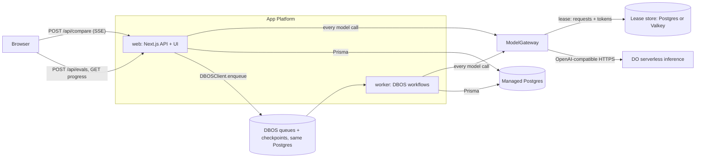
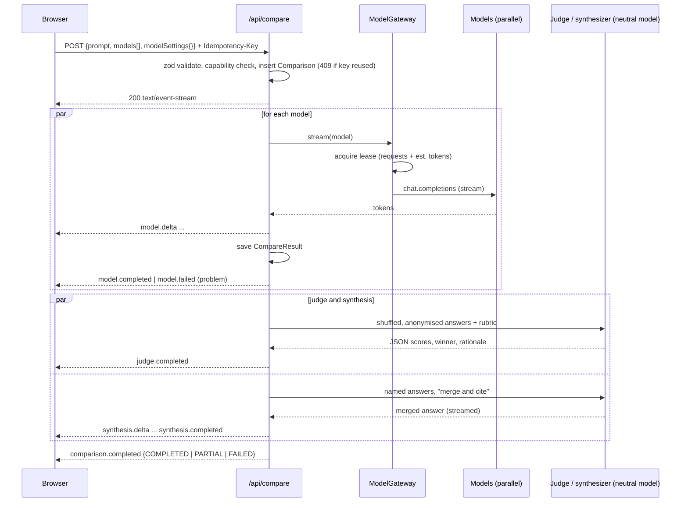

# Architecture and design decisions

## 1. The problem

### Framing

**Model FOMO** is decision anxiety: "did I pick the right model for *my* prompts, or am I overpaying / under-serving because I don't know what else is out there?" Customers on DigitalOcean can call dozens of hosted models through one key, which makes the choice cheap to change but hard to make.

**Personas**

| Persona | Situation | What they need |
| --- | --- | --- |
| App developer (primary) | Building a feature on DO serverless inference, picked a model from a blog post. | A fast, concrete answer for their prompt: which model, at what cost and latency. |
| Tech lead / platform owner | Owns the AI bill and quality bar for several features. | Evidence across many prompts, and a way to re-check when models change (DO keeps only the latest versions of each model). |
| PM / non-specialist | Wants to sanity-check output quality without reading API docs. | A UI where they can compare answers and say which one is better. |

**Job to be done:** *"When I'm choosing (or re-choosing) a model for a task, help me see how the alternatives compare on my prompts, so I can pick one with confidence and move on."*

**What success looks like** (PoC and beyond, see ROADMAP for later phases)

- Time from question to decision: one compare run gives a recommendation in under a minute.
- Decision confidence: share of comparisons where the user votes or rates (a proxy for "this was useful"), and judge/human agreement.
- Money saved: share of users who switch to a cheaper model at equal judge quality after validating on their prompts.
- Reliability: compare runs completing without a model error; 429s absorbed by the gateway rather than shown to users.

### How the PoC answers it

1. **Interactive compare.** One prompt, up to six models, each with its own settings (temperature, top P, max tokens, reasoning level, system prompt override), streaming side by side with latency, tokens and cost.
2. **Combined view, three ways.** (a) a **judge** scores the anonymised answers; (b) a **synthesizer** merges them into one answer that cites which model each part came from; (c) a **recommendation** turns judge quality plus cost and latency into "use X", weighted by the user's priority (quality, balanced, cost, speed), e.g. *"GLM-5.3 Flash is 95% as good as DeepSeek at 1/10th of the cost."*
3. **Human signal.** Thumbs up/down per answer and a "best answer" vote, stored for judge calibration and future tuning.
4. **Batch evals.** One prompt is an anecdote. A batch run takes a prompt set × model set, runs every call in a durable worker, judges each prompt, and feeds a leaderboard that can be cut by task type.
5. **Validate on my prompts.** From a compare result, one click turns that compare into a batch eval over the user's own prompts, with the same models, per-model settings, task type and priority. The run page recomputes the recommendation from the averages across all prompts.

Everything runs on DigitalOcean: models from **serverless inference** (OpenAI-compatible, `https://inference.do-ai.run/v1`, model access key), compute on **App Platform**, state in **Managed Postgres**, optionally **Managed Caching (Valkey)**.

### Caveat: what this account can call

On the account this PoC runs on, every Anthropic model and every proprietary OpenAI model returns `403 "not available for your subscription tier"`; `gpt-oss-120b` and the open-weight families (DeepSeek, GLM, Kimi, Qwen, MiniMax, Mistral, NVIDIA) work. That means the demo cannot show the most common FOMO question, *"is a cheap open model good enough versus a frontier model?"*. The catalog still lists the locked models (with "Not on plan") so the experience is honest about what exists. On a higher tier nothing in the code changes.

## 2. System overview



Two paths with different needs:

| | Interactive compare | Batch evals |
| --- | --- | --- |
| User expectation | First token in about a second, finished in seconds | Minutes are fine, must not lose work |
| Transport | SSE stream from the web service | `202 Accepted`, then poll progress |
| Executes in | Web request | Worker (DBOS durable workflows) |
| On a crash | User clicks run again | Workflow resumes from its last checkpoint |
| Retry budget | Small (3 attempts, 15 s queue wait) | Large (5 attempts, 5 min queue wait) |

Both paths share one choke point for model calls, `ModelGateway`, so retries, timeouts and the rate-limit budget behave the same everywhere.

### Repository layout

A pnpm + Turborepo monorepo. Packages ship TypeScript source (no build step); Next.js transpiles them and the worker runs on `tsx`.

```
apps/web            Next.js App Router: UI, API routes, middleware
apps/worker         DBOS worker: eval workflows and queues
packages/shared     zod request schemas, SSE event types, RFC 9457 types (used by server AND client)
packages/llm        ModelGateway, Gradient + mock providers, judge, model catalog/pricing
packages/ratelimit  Lease-based rate limiter with Postgres / Redis / memory stores
packages/db         Prisma schema, migrations, client
```

Splitting `llm` and `ratelimit` out of the web app is what lets the worker reuse them unchanged.

## 3. Interactive path: `POST /api/compare`



Design points:

- **Validate before streaming.** Validation, the idempotency check and the database insert happen before the response starts, so those errors get a real HTTP status and a problem body. Once the stream is open, the HTTP status is already 200, so failures become events.
- **Per-model isolation (partial results).** Each model runs in its own promise that catches its own errors and always emits exactly one terminal event (`model.completed` or `model.failed`). This is `Promise.allSettled` semantics, written so each model also persists and reports as soon as *it* finishes rather than waiting for the slowest one.
- **Three timeouts.** A per-attempt timeout (60 s), a first-token timeout (20 s, catches stuck requests early), and an overall deadline for the comparison (150 s).
- **Retries only before the first token.** If a stream fails after text reached the user, retrying would duplicate text on screen. The gateway retries only failures that happen before any token was sent; later failures surface as `model.failed` with the partial output kept.
- **Client disconnect cancels upstream calls.** The request's `AbortSignal` flows down to the OpenAI SDK, so closing the tab stops spending tokens.
- **SSE, not WebSockets.** The flow is one-way (server to browser), SSE works over plain HTTP through App Platform's load balancer, and the client is about 30 lines. We use `fetch` + a small parser instead of `EventSource` because `EventSource` cannot POST a body. A heartbeat comment every 15 s keeps idle connections open through proxies.
- **Metrics per model:** time to first token, latency of the successful attempt, input/output tokens (from the provider's `usage`, or estimated and flagged with `*` if not reported), cost from the price table, and attempt count.

### The combined view: LLM-as-judge

After the answers finish, a judge model scores each one on accuracy, helpfulness, clarity and overall (1-10), picks a winner and writes a short rationale. Known judge biases and what we do about each:

| Bias | Mitigation |
| --- | --- |
| Position bias (favours the first answer) | Answers are shuffled before judging. |
| Self-preference (a model likes its own style) | Answers are anonymised as "Response A/B/C", and the judge is picked to be a model that is **not** competing (`pickJudgeModel` walks a preference list). If none is free, the verdict is flagged `selfJudged` and the UI shows a warning. |
| Verbosity bias | The rubric says not to reward length. |
| Prompt injection inside an answer | The rubric tells the judge to ignore instructions inside responses. |
| Unparseable output | Strict JSON contract validated with zod; one automatic re-ask on bad JSON; unknown labels are dropped. |

The judge is a second opinion, not ground truth, and the UI says so. Human votes (`PUT /api/compare/:id/vote`) are stored next to the judge's verdict. They measure judge/human agreement and are the seed data for the "learn from preferences" roadmap item.

### Synthesis: one merged answer, with attribution

The judge tells you *which* answer is best; the synthesizer gives you *the* best answer. It runs in parallel with the judge (both only need the finished answers), uses the same neutral model, and is told to keep only what the answers contain, resolve disagreements explicitly, and cite each sentence as `[Model name]`. The UI renders citations as chips, so the merged answer never hides where each claim came from, which is the point of FOMO. The output is stored on `Comparison.synthesis`.

Embedding-similarity consensus was considered and rejected: cheap, but agreement is not correctness.

### Recommendation: from scores to a decision

`apps/web/lib/recommend.ts` is a small pure function. Each answered model gets three 0..1 sub-scores: quality (judge overall / 10), cost (cheapest / this), speed (fastest / this). The user's priority picks the weights (quality 1/0/0, balanced 0.6/0.25/0.15, cost 0.4/0.6/0, speed 0.4/0/0.6) and the highest weighted sum wins. The sentence compares the pick to the highest-quality answer ("95% as good at 1/10th of the cost"). Unknown prices score as worst-case cost so we never recommend on a guess. The card says plainly that one prompt is a sample of one and offers **Validate on my prompts** (next section).

### Validate on my prompts: from one sample to many

The button on the recommendation card opens a drawer prefilled with the compare's prompt; the user adds their own, one per line (`prompt => expected` adds a reference answer for the judge). It posts a normal `POST /api/evals` with the models, per-model settings, task type and priority that the compare *actually sent* (a snapshot taken at run time, so later edits to the form don't leak in) plus `sourceComparisonId`. The compare's shared system prompt is folded into each model's `systemPrompt` because evals have no shared one. The drawer estimates cost as this compare's cost × number of prompts.

The run page then shows the same recommendation, computed by `aggregateResults()` in `recommend.ts`: per model, the mean judge score over its judged answers, mean latency and mean cost per prompt, with failures counted separately. The priority picker starts from the run's stored priority and can be changed after the fact. The leaderboard takes `?task=<type>` (UI pills, and `taskType` on `GET /api/leaderboard`), because "best model" depends on the job.

### Per-model settings and capabilities

Each selected model carries its own `temperature`, `topP`, `maxTokens`, `reasoningEffort` and `systemPrompt` override (`modelSettings` in the request, validated with zod; keys must be in `models`). Not every model accepts every parameter, so on 2026-11-26 we **probed every chat model** on DO with each parameter. Findings, encoded in `packages/llm/src/catalog.ts`:

| Model | Rejects |
| --- | --- |
| Kimi K2.6 | `temperature` (must be 1), `top_p` (must be 0.95) |
| Kimi K3 | `top_p` (must be 0.95) |
| Ministral 3 14B, GLM-5.2 | `reasoning_effort` |
| All Anthropic, proprietary OpenAI, Arcee | everything (403, not on this account's tier) |

The UI disables unsupported controls with the reason, the server rejects explicit unsupported settings with a 400 problem pointing at the exact field, and request-level defaults (e.g. temperature 0.7) are silently left out for models that reject them. What was actually sent is stored per result (`CompareResult.settings`) so any comparison can be reproduced.

### Reasoning models and timeouts

Reasoning models (GLM, Kimi, DeepSeek, gpt-oss) stream hidden "thinking" before any answer text, sometimes for 20-30 s. The original first-token timeout (20 s) killed them before they answered. The provider now reports reasoning chunks as a liveness signal (`{type: "thinking"}`), which stops the first-token timer without counting as TTFT. And if a model spends its whole `max_tokens` on reasoning (`finish_reason: "length"` with no text), the call fails with a clear, non-retryable message ("raise max tokens or lower the reasoning level") instead of showing an empty "Done" panel. The default max tokens in the UI is 2048 for this reason.

## 4. Reliability: the `ModelGateway`

Every model call, from the web app or the worker, goes through `ModelGateway` (`packages/llm/src/gateway.ts`). Each attempt:

1. **Takes a lease** from the shared rate limiter (one request + estimated tokens).
2. **Calls the provider** with a per-attempt timeout (and a first-token timeout for streams).
3. **Releases the lease** with the actual token usage.

### Retries: exponential backoff with full jitter

Retried: 429, 408, 409, 425, 5xx (including 529 "overloaded"), timeouts and network errors. Not retried: other 4xx (bad request, unknown model, auth), because they fail the same way again.

```
delay = random(0, min(cap, base * 2^(attempt-1)))      # full jitter
if the server sent Retry-After / retry-after-ms:
  delay = max(retryAfter + small random spread, delay)   # never earlier than asked
```

Full jitter (randomising the whole delay, not adding a little noise) spreads retries from many clients evenly, so they don't all hit the provider again at the same instant after a shared 429. The OpenAI SDK's built-in retries are turned off (`maxRetries: 0`) so attempts don't multiply across two layers.

### Staying under the limits: leasing

Retrying 429s is reactive. To stay *within* the limits in the first place, every process takes a **lease** from a shared store before calling a model.

**The real numbers.** DO doesn't publish per-model limits for serverless inference, but every response carries `x-ratelimit-*` headers. Measured on 2026-11-26 with this project's key:

| Header | glm-5.3-flash | mistral-3-14B | Notes |
| --- | --- | --- | --- |
| `limit-requests` | 120 | 120 | per minute, **per model** (each model has its own counter) |
| `limit-tokens-per-minute` | 1,500,000 | 1,000,000 | differs by model |
| `limit-tokens-per-day` | 45,000,000 | 30,000,000 | |
| `remaining-tokens-per-day` | ~4.5M | ~3.0M | about 10% of the limit right after light use; we trust the smaller number |
| `reset-*` | epoch seconds | epoch seconds | e.g. `1795712400`, the next minute boundary |

So the budget is **per (access key, model)**, not per account, and the right numbers have to be learned rather than configured.

**The strategy:**

1. **One bucket per (key, model).** Bucket name `gradient:<sha256(key)[:10]>:<model>`: two keys never share a budget, and the key itself is never stored. (`RATE_LIMIT_BUCKET=account` collapses to one bucket per key for providers that limit per account.)
2. **Learn limits from headers.** The provider parses the headers on every response (and on 429 errors) and the gateway calls `limiter.observe()`. Learned limits replace the configured fallback (`RATE_LIMIT_RPM`/`TPM`, used until the first response) at 90% (`LEARNED_SAFETY`), and expire after an hour without a fresh header. If a header says a counter is at **0 remaining** (per minute or per day), the bucket is put into cooldown until that counter's reset, instead of collecting 429s.
3. **Reserve the worst case, then reconcile.** A lease reserves 1 request and *prompt estimate + `maxTokens`* tokens inside a sliding 60 s window, plus an in-flight slot (with a TTL, so a crashed caller can't hold it). On completion the estimate is replaced with the real usage, which returns unused budget. Failed attempts are charged 0 tokens for a 429/4xx (rejected before generation) and the full reservation for timeouts/5xx (unknown, so we over-count, the safe direction).
4. **Priority lanes.** Compare (a person watching a stream) uses the `interactive` lane; batch evals and their judge use `batch`. Batch may fill only `RATE_LIMIT_BATCH_SHARE` (default **0.3**) of each limit, counting *all* usage in the bucket, so interactive always has at least 70% of a model's capacity to itself. When the system is idle, interactive can use everything; batch never pushes a model past 30%. With 120 RPM per model that is 36 batch calls/min per model, so a 50 prompt × 3 model eval still finishes in about 1.5 minutes.
5. **AIMD when the limits are wrong.** Each bucket has a factor (starts at 1) that scales all its limits. A 429 halves it (multiplicative decrease, at most once per cooldown so a burst of parallel 429s counts once, floor 0.1); each finished call adds 0.05 (additive increase). This finds the real capacity when another app shares the key or the provider changes limits without saying so. The 429 also sets a **shared cooldown** for the `Retry-After` period, so every instance backs off, not just the one that got it.
6. **Waiting.** With no capacity, the caller sleeps (with jitter) until the oldest lease leaves the window, up to its wait budget (15 s interactive, 5 min batch). The UI shows "waiting for capacity".

Because the web instances and the worker lease from the same store, the *whole system* stays under the limits. Per-process limiters would each think they had the full budget.

The arithmetic lives in `packages/ratelimit/src/policy.ts` (`effectiveLimits`):

```
base      = learned limit × 0.9, or the configured fallback
effective = base × aimdFactor × (lane == batch ? batchShare : 1)
```

### Lease stores: Valkey recommended, Postgres fallback

`LeaseStore` is a small interface (`tryAcquire(bucket, tokens, limits, lane)`, `release`, `coolDown`, `observe`) with three implementations that pass the same contract test suite (lanes, learned limits, AIMD, reconciliation, cooldowns, and "20 concurrent acquires never over-grant"), run against real Valkey and Postgres locally.

| | Valkey (DO Managed Caching) | Postgres | Memory |
| --- | --- | --- | --- |
| Selected by | `LEASE_STORE=redis` or just `REDIS_URL` set | `LEASE_STORE=postgres` (default without `REDIS_URL`) | `LEASE_STORE=memory` |
| Atomicity | One Lua script per operation (`EVALSHA`) | Transaction + `pg_advisory_xact_lock(hashtext(bucket))` | Single thread |
| Clock | Valkey `TIME` | Database `now()` | Process clock |
| Learned limits + AIMD factor | In Valkey, shared by every instance | Per process | Per process |
| Cost per acquire | One round trip (<1 ms) | A short transaction (~1-3 ms) | None |
| Good for | Production: many instances, high call rates | No extra infra; moderate traffic | Unit tests, one process |

Valkey is the better fit: leases are short-lived counters, Lua makes check-and-take one atomic step without table locks, keys expire on their own (no cleanup), and learned limits and the AIMD factor are shared, so one instance's 429 slows everyone down. Keys for a bucket share a `{hash tag}`, so they land on one shard if the cluster is ever sharded. **The live PoC runs on Postgres**: the DO team account is at its database cluster limit, so no new Valkey cluster was created; switching is one secret (`REDIS_URL`) and a redeploy. Postgres stays as the fallback behind the same interface: zero extra infrastructure, and at tens of calls per second a short transaction is negligible next to a multi-second model call. Losing Valkey loses only the last minute of lease history; the worst case is a brief burst of 429s, which the retry and AIMD logic absorb.

Two layers of flow control exist in the batch path and that's deliberate: DBOS queue concurrency and rate limits are **coarse, per-worker** limits that stop the worker from starting hundreds of steps that would only sit waiting; the lease store is the **precise, global** budget shared with the web app.

## 5. Batch path: durable evals with DBOS

`POST /api/evals` writes the run (prompts, models, judge, task type, priority, per-model settings, and the source comparison if it came from "Validate on my prompts") and enqueues one workflow. Each model call is built by the same `buildModelRequest()` as compare, so the eval runs the settings the user picked. The worker executes:

```
evalRunWorkflow(run)                          queue: eval-runs     (2 per worker)
  └─ evalPromptWorkflow(run, prompt i)        queue: eval-prompts  (8 per worker)
       ├─ modelCallWorkflow(run, i, model)    queue: model-calls   (8 per worker, 60/min)
       └─ step: judge prompt i
  └─ step: finalize run (COMPLETED | PARTIAL | FAILED)
```

**Why durable workflows?** A 50 prompt × 5 model run is 250 paid model calls plus 50 judge calls, over several minutes. App Platform redeploys and restarts containers. Without durability, a restart either loses the run or re-runs everything and pays twice. DBOS checkpoints each step's result in Postgres. After a crash, the next worker resumes each workflow from its last completed step.

Verified locally: killing the worker with `kill -9` after 13 of 36 model calls, then restarting it, completed the run with exactly 36 `callModel` step outputs in DBOS's tables (no call made twice).

**Idempotency at every layer:**

- **HTTP:** `Idempotency-Key` on `POST /api/evals`. Same key + same body returns the original run (`200`, `Idempotent-Replayed: true`). Same key + different body returns `422`. A sha256 of the body is stored to tell them apart.
- **Enqueue:** the DBOS workflow ID *is* the run ID (`workflowIDReusePolicy: return-existing`), so enqueueing twice is a no-op. If the process dies between "row written" and "job enqueued", retrying the POST with the same key re-enqueues it, which heals that gap without an outbox table.
- **Children:** child workflow IDs are derived from the run (`<run>:p<i>:<model>`), so a replayed parent finds its existing children instead of creating new ones.
- **Writes:** results are upserts on natural keys (`runId, promptIndex, model`), and status changes are guarded updates (`WHERE status IN ('QUEUED','RUNNING')`), so a step that re-executes after a crash (written but not yet checkpointed) is harmless, and a cancelled run is never resurrected.

**Failure semantics:** a model that fails is recorded as a failed cell, not thrown, so one bad model never aborts a run (`PARTIAL`). DBOS step retries are kept for infrastructure blips (a dropped DB connection); model-level retries stay in the gateway.

**Cancellation:** `POST /api/evals/:id/cancel` calls `cancelWorkflow(id, { cancelChildren: true })` and marks the run cancelled.

### Why DBOS (and not Temporal, BullMQ or a cron)

| Option | Verdict |
| --- | --- |
| **DBOS** (chosen) | A library, not a service: workflows are plain TypeScript, state lives in the Postgres we already run. Queues with concurrency and rate limits, child workflows, cancellation and a client for enqueueing from another process are built in. One less thing to deploy on App Platform. |
| Temporal | The most mature option and the right call at larger scale or for multi-team orchestration. But it needs its own cluster (frontend, history, matching services and a database). That's a poor fit for App Platform; you'd use Temporal Cloud or run it on DOKS. Too much infrastructure for this PoC. |
| BullMQ | Simple queues, but needs Redis, and gives at-least-once jobs, not durable multi-step workflows. We'd hand-roll checkpointing. |
| Plain table + polling worker | Fine for one step. Fan-out, child results, retries and resumption is exactly what DBOS already does. |

Tradeoff accepted: DBOS ties workflow state to Postgres, so Postgres throughput bounds the workflow throughput. That's far beyond what model-call rate limits allow anyway.

## 6. API design

- **Validation:** every route is wrapped by `apiRoute()` (`apps/web/lib/server/api.ts`), which parses params, query and body with zod schemas from `packages/shared`. The client imports the same inferred types, so client and server cannot drift. The wrapper also enforces `Content-Type: application/json` (415), a 1 MB body limit (413) and valid JSON (400).
- **Errors: RFC 9457 Problem Details.** Every error is `application/problem+json`:

  ```json
  {
    "type": "/problems/validation-error",
    "title": "Validation failed",
    "status": 400,
    "detail": "The request is invalid.",
    "instance": "/api/compare",
    "requestId": "6b93f687-…",
    "errors": [{ "pointer": "body.models", "message": "Models must be unique" }]
  }
  ```

  `type` URIs resolve to human-readable docs at `/problems/<slug>`, as the RFC recommends. Extension members: `requestId` (ties a client error to the server log line), `errors` (field-level validation), `retryAfterMs`, `model`, `upstreamStatus`. Unknown errors become a generic 500 with no internal details leaked (tested). The same problem shape is used inside SSE `model.failed` / `judge.failed` events and stored with failed results, so a failure looks the same everywhere. Unknown `/api/*` paths return a problem-shaped 404, not Next's HTML page.
- **Status codes that mean something:** `202 Accepted` + `Location` for async eval runs, `409` for a reused compare key (with the existing `comparisonId`), `422` for a key reused with a different body, `503` + `Retry-After` when a dependency is down.
- **Idempotency:** `Idempotency-Key` header (IETF draft) on the two POSTs that cost money; `PUT` for votes, which is idempotent by definition.
- **Pagination:** cursor based (`?limit&cursor`), stable under inserts.
- **Middleware, ready for auth:** `middleware.ts` assigns or propagates `x-request-id` and calls `authenticate()`, which today returns an anonymous principal. Adding auth means implementing that one function (verify a session, JWT or API key, return `null` for 401). Route handlers already receive `principal`. The principal header is always overwritten by middleware, so clients cannot spoof it.
- **Observability:** one structured JSON log line per request (request id, method, path, status, duration), plus warnings per failed model call.

## 7. Data model

`Comparison` → `CompareResult` (one per model), `Judgement`, `Vote`. `EvalRun` → `EvalPrompt` (judge winner and rationale) → `EvalResult` (one per prompt × model, with judge score). `rate_lease` and `rate_cooldown` back the Postgres lease store. DBOS keeps its own tables in a separate `dbos` schema/database.

Metrics are stored per call so the leaderboard can compute averages, win rates and error rates. It aggregates on read, which is fine at PoC scale; at scale it becomes a materialised view refreshed by the worker.

## 8. Deployment on App Platform

`.do/app.yaml`:

- **web** service: Dockerfile build, health check on `/api/health` (checks the database).
- **worker**: same image, `COMPONENT=worker`. Stateless; scale by adding instances (DBOS coordinates queue consumers through Postgres).
- **migrate**: a `PRE_DEPLOY` job running `prisma migrate deploy`, so the schema is migrated before new code takes traffic.
- **Managed Postgres**. DBOS uses the same database in its own `dbos` schema. Locally docker compose creates a separate `fomo_dbos` database.
- Secrets (`type: SECRET`): `DO_MODEL_ACCESS_KEY`, `DATABASE_URL`, `DBOS_SYSTEM_DATABASE_URL`. `DATABASE_CA_CERT` holds DO's CA (see below).

One root `Dockerfile` builds every component; the `COMPONENT` build arg (App Platform passes `BUILD_TIME` env vars as `--build-arg`) selects the final stage.

**The live PoC** runs a dev-sized variant of the spec: 1 web + 1 worker instance (`apps-s-1vcpu-1gb`), and a separately created Managed Postgres cluster (`db-s-1vcpu-1gb`, nyc3) wired in by secret URLs rather than the spec's `databases:` block (the account's database limit refused a spec-managed cluster). About $36/mo for the app plus $15/mo for the database.

**TLS gotcha.** DBOS talks to Postgres through node-postgres, which treats `sslmode=require` as `verify-full`, while Prisma does not. DO Managed Postgres signs with a per-account CA, so the first deploy's batch evals hung on "self-signed certificate in certificate chain". The fix keeps full verification: `DATABASE_CA_CERT` (from `doctl databases get-ca`) is written to a temp file and passed as `sslrootcert` (`packages/db/src/dbos-url.ts`). Turning verification off was rejected.

Operational notes: each process opens a Prisma pool plus a DBOS pool. Small managed Postgres plans allow about 20-25 connections, so add a connection pool (PgBouncer, built into DO Managed Postgres) before scaling out instances. SSE responses need `maxDuration` long enough for the slowest model (set to 180 s).

### Why App Platform, and when DOKS

| | App Platform (chosen) | DOKS + Helm (documented, not provisioned) |
| --- | --- | --- |
| Setup | One spec file, builds from GitHub on push, managed TLS and load balancing. | Cluster, ingress controller, cert-manager, registry, image builds in CI. |
| Cost at PoC size | ~$36/mo (2 × 1 GB containers) | ~$41/mo minimum (1 × 4 GB node $24 + load balancer $12 + registry $5), more for HA. |
| Operations | Nothing to patch; logs and metrics built in. | Node upgrades, ingress, cert renewals, observability are ours. |
| Flexibility | No sidecars, no custom autoscaling signals, no GPU, per-component sizes only. | Anything Kubernetes can do: HPA on queue depth, sidecars (OTel collector), co-located self-hosted models or observability (Langfuse/SigNoz). |

App Platform is the right call for the PoC and for a first production version. Move to DOKS when one of these becomes true: the worker needs to autoscale on queue depth, we self-host something next to the app (observability stack, a reranker, a small fine-tuned model on GPU nodes), or several services share one cluster. The Helm chart in `deploy/helm/model-fomo` is ready for that move (web Deployment + Service + Ingress, worker Deployment, migration Job as a pre-install/pre-upgrade hook, Secrets, probes and resources). We briefly provisioned a cluster and deleted it unused: for one app, the extra moving parts bought nothing yet.

## 9. Technology choices and tradeoffs

| Choice | Why | Tradeoff |
| --- | --- | --- |
| **TypeScript end to end** | One language for UI, API, worker and shared types; zod schemas shared by client and server. Fast to iterate, easy to review. | **Why not Rust:** the work is I/O-bound (waiting on models), so Rust's CPU advantages don't matter here, and it would split the codebase across two languages and slow the PoC. Revisit for a high-throughput gateway proxy. |
| **Next.js route handlers as the API** | One deployable for UI and API, native streaming responses. | API scaling is coupled to UI scaling. If the API grows, the `llm`/`ratelimit` packages lift out into a standalone service unchanged. |
| **OpenAI SDK against DO's endpoint** | DO serverless inference is OpenAI-compatible; the official SDK gives typed streaming and error classes. | Provider-specific features (if any) need a different client. `ChatProvider` is the seam. |
| **Prisma** | Typed queries, migrations, readable schema. | Raw SQL is still used where it's clearer (advisory locks in the lease store). |
| **Postgres for everything** (data, workflows, leases) | One managed dependency to run, back up and reason about. | It becomes the bottleneck first; Valkey for leases is already a config switch. |
| **SSE over WebSockets** | One-way stream, plain HTTP, trivial client. | No client-to-server messages mid-stream (not needed: cancel = close the request). |
| **LLM-as-judge for the combined view** | Scales, explains itself, works on any prompt with no labels. | Biased and fallible; mitigated (section 3) and paired with human votes. |

## 10. Known limitations

- Token estimates use ~4 characters/token; a real tokenizer per model family would tighten lease reservations.
- `stream_options.include_usage` is requested for streaming usage; DO's docs don't say whether it's honoured. If it isn't, tokens are estimated and flagged. Set `GRADIENT_STREAM_USAGE=0` if the endpoint rejects it.
- No auth, per-user quotas or inbound rate limiting yet (the middleware hook is where they go).
- Prices are a static table from DO's pricing page (2026-11-26) using the base tier; long-context tiers aren't modelled.
- The leaderboard mixes judge scores from different prompts and judges; it's indicative, not a benchmark.
- Model capabilities and plan availability are a static table from one probe (2026-11-26). A periodic re-probe (or reading DO's model metadata, if it exposes this) would keep it current.
- Tool calling is shown in the UI as "coming later" and is not implemented.
